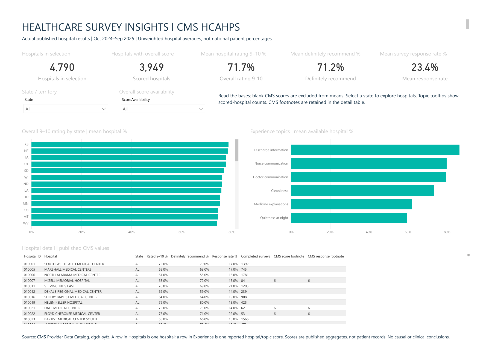

# Healthcare Survey Insights

A beginner BI portfolio project using **Python, pandas and Power BI** to explore published hospital patient-experience survey results.

**Question:** How do hospital survey scores differ across states and experience topics, and how many hospitals have an available score?



[Download the Power BI report](HealthcareSurvey.pbix)

## Project structure

```text
healthcare-survey-powerbi/
├── README.md
├── HealthcareSurvey.pbix
├── prepare_data.py
├── requirements.txt
├── data/
│   ├── hcahps_raw.csv
│   └── hospital_summary.csv
└── screenshots/
    └── dashboard.png
```

The two hidden Git configuration files control ignored files and line endings. The report contains its Power Query steps, model, DAX measures and visuals; there is no separate report-source folder to navigate.

## Data source

The dataset is [CMS Patient survey (HCAHPS) - Hospital](https://data.cms.gov/provider-data/dataset/dgck-syfz), published by the U.S. Centers for Medicare & Medicaid Services.

| Item | This snapshot |
| --- | --- |
| Reporting period | 1 October 2024 to 30 September 2025 |
| Downloaded | 4 November 2026 |
| Selected source rows | 38,320 |
| Hospitals | 4,790 |
| Measures selected | Eight, listed in prepare_data.py |

`hcahps_raw.csv` is an unchanged-values subset of the official download: eight measure rows per hospital. It retains published questions, answers, percentages, survey metadata and footnotes. No survey records were generated. A source row is a **hospital/measure result**, not an individual patient.

[Original CSV download](https://data.cms.gov/provider-data/sites/default/files/resources/78a50346fbe828ea0ce2837847af6a7c_1785189950/HCAHPS-Hospital.csv) · [CMS data dictionary](https://data.cms.gov/provider-data/sites/default/files/data_dictionaries/hospital/HOSPITAL_Data_Dictionary.pdf)

Selected-source SHA-256: `af8a730ab5969ee4def5d33890a8f237355f34f532e31cbf2aa0ba40ae419a71`.

## Open the dashboard

1. Install [Power BI Desktop](https://learn.microsoft.com/en-us/power-bi/fundamentals/desktop-get-the-desktop) on Windows if needed.
2. Open `HealthcareSurvey.pbix`. It includes the imported data, so you can explore it immediately.
3. Choose a state in the State/territory filter. Watch the cards, charts and hospital table change.

**To refresh after moving/downloading the folder:** use **Home -> Transform data -> Edit parameters**. Set **DataFile** to the full path of `data/hospital_summary.csv`, then apply and refresh. The saved report's original local path does not automatically change when a folder moves. No Python code is needed just to view the saved report.

## Run the Python cleaning

Open PowerShell in the folder containing `prepare_data.py`. Use Python 3.10 or 3.11:

```powershell
python -m venv .venv
.\.venv\Scripts\python.exe -m pip install -r requirements.txt
.\.venv\Scripts\python.exe prepare_data.py
```

The script rebuilds `data/hospital_summary.csv` from the included source CSV and prints the five headline figures. It does not download changing data or create extra report files. On later runs, use only the last command. These commands need no environment activation or PowerShell policy change.

## Learn the cleaning script in six steps

Read `prepare_data.py` from top to bottom. Its numbered comments match this table.

| Step | What the code does | Beginner meaning |
| --- | --- | --- |
| 1. Read | `pd.read_csv()` | Load the CSV into a dataframe, a table in Python memory |
| 2. Check | Look for repeated keys, different periods and unexpected measures | Validate inputs before using them |
| 3. Convert | `pd.to_numeric(..., errors="coerce")` | Turn number text into numbers; unavailable text becomes missing |
| 4. Pivot | `survey.pivot(...)` | Turn eight measure rows for a hospital into eight score columns |
| 5. Join | `hospitals.join(score_table)` | Attach scores to each hospital's name, location and metadata |
| 6. Save | `.to_csv()` and `.mean()` | Export the clean table and calculate reference figures |

`MEASURES` is a dictionary mapping CMS codes to readable names. `HospitalID` stays text to preserve leading zeros. Missing scores stay missing: filling them with zero would invent a negative response. Percentages become fractions because Power BI displays `0.72` as `72%`.

## Understand the Power BI model

The main **Hospitals** table contains one row per hospital. Power Query also creates **Experience** by turning six topic columns into rows: HospitalID, Topic and ScorePct. This is called **unpivoting**.

Hospitals connects to Experience through HospitalID, using a one-to-many relationship. Selecting a state filters the hospitals and their topic scores. You can inspect the relationship in Model view and the import/unpivot steps under Transform data.

The dashboard has five cards, two filters, a state comparison chart, a topic comparison chart and a hospital detail table. The charts and table scroll to show additional values.

These are the main DAX measures saved inside the report:

```dax
Hospitals in selection = COUNTROWS('Hospitals')

Scored hospitals = COUNT('Hospitals'[OverallRatingPct])

Overall rating 9-10 = AVERAGE('Hospitals'[OverallRatingPct])

Definitely recommend = AVERAGE('Hospitals'[RecommendPct])

Mean response rate = AVERAGE('Hospitals'[ResponseRatePct])

Mean topic score = AVERAGE('Experience'[ScorePct])
```

Each is a separate measure. A **measure** is a formula recalculated for the current selection. `COUNTROWS` counts all selected hospital rows; `COUNT` counts available numeric scores; `AVERAGE` ignores blanks. A state chart is like SQL `GROUP BY State`: the measure is calculated within each state's rows.

## Findings and checks

With filters cleared, the report and Python output show:

| Measure | Value |
| --- | ---: |
| Hospitals | 4,790 |
| Hospitals with an overall score | 3,949 |
| Mean hospital overall 9-or-10 percentage | 71.7% |
| Mean hospital definitely-recommend percentage | 71.2% |
| Mean hospital survey response rate | 23.4% |

- **841 hospitals** have no available overall score. Keep them in the table and show the scored-hospital count beside the mean.
- Across the six topics, mean positive-answer scores range from **59.5% for quietness at night** to **86.5% for discharge information**. These are different questions, so the gap is descriptive.
- For a real follow-up, investigate lower-scoring topics within an appropriate hospital/state context and review survey coverage and CMS footnotes before proposing changes. No intervention or improvement was measured here.

The original preparation was checked against source values and independent SQL calculations. The simpler script was checked to reproduce the same hospital table. The saved report was refreshed and checked in Power BI Desktop. Selecting Alabama produced 90 hospitals, 73 with an overall score, and a 70.5% mean overall score; the topic chart also changed.

## Explain it in an interview

After running and reviewing the project, explain the flow in your own words: **public CSV -> pandas cleaning -> cleaned CSV -> Power BI measures and charts -> findings**.

Be ready to answer these five questions:

1. What does a row represent? One hospital in the cleaned table; one hospital/measure in the source.
2. What does 71.7% mean? An **unweighted average of available hospital percentages**, not the percentage of all U.S. patients who gave a positive answer.
3. Why keep blanks? An unavailable score is different from zero satisfaction.
4. What is survey bias? People who answer may differ from people who do not. More responses do not automatically remove that bias.
5. What happens when a state is selected? The same DAX formulas recalculate for that state's hospitals and related experience scores.

CMS publishes adjusted survey aggregates; this project uses those results as supplied. It does not reconstruct patient counts, official national/state benchmarks, causal effects or clinical outcomes. The overall rating question uses a **0-10 scale**, with 9-10 as its top box. Other measures use answers such as always, yes or definitely recommend.

## Share the project

Commit this folder's contents so README.md is at the GitHub repository root. The preview image will display on that page; visitors can download the PBIX to explore it. Use the actual repository URL beside the project title on your resume. A public interactive Power BI link can be added later if your service account permits Publish to web.

Development note: this guided portfolio project was prepared with AI assistance. It uses actual published CMS data and does not claim survey fielding, institutional partnerships or measured business improvement.
